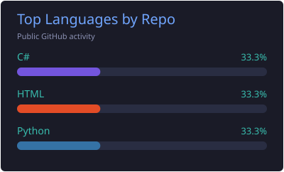
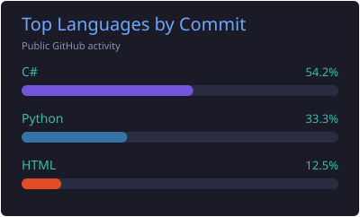

<h1 align="center">Hi, I'm Luimya 👋</h1>

Welcome to my little corner of GitHub.

  <a href="https://github.com/Luimya?tab=repositories">Repositories</a>
  &nbsp; · &nbsp;
  <a href="https://github.com/Luimya?tab=stars">Stars</a>

  

## Languages

  
  

## Activity

  
  

## Visits

  

## Contribution Snake

  <picture>
    <source media="(prefers-color-scheme: dark)" srcset="assets/github-contribution-grid-snake-dark.svg" />
    <source media="(prefers-color-scheme: light)" srcset="assets/github-contribution-grid-snake.svg" />
    
  </picture>

<!-- Layout inspired by https://github.com/1cyberlangke1/1cyberlangke1 -->
<!-- Components: vn7n24fzkq/github-profile-summary-cards, journey-ad/Moe-Counter, Platane/snk -->
