  

  <picture>
    <source media="(prefers-color-scheme: dark)" srcset="assets/github-contribution-grid-snake-dark.svg" />
    <source media="(prefers-color-scheme: light)" srcset="assets/github-contribution-grid-snake.svg" />
    
  </picture>

  

<!-- Design: “Pixel” — retro RPG / arcade HUD -->
<!-- Components: journey-ad/Moe-Counter, Platane/snk -->
